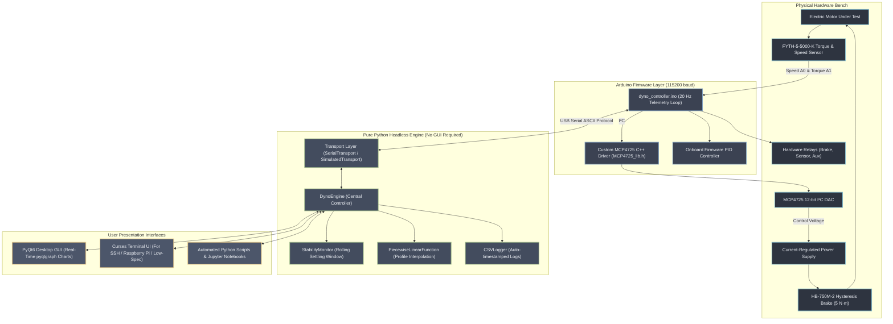
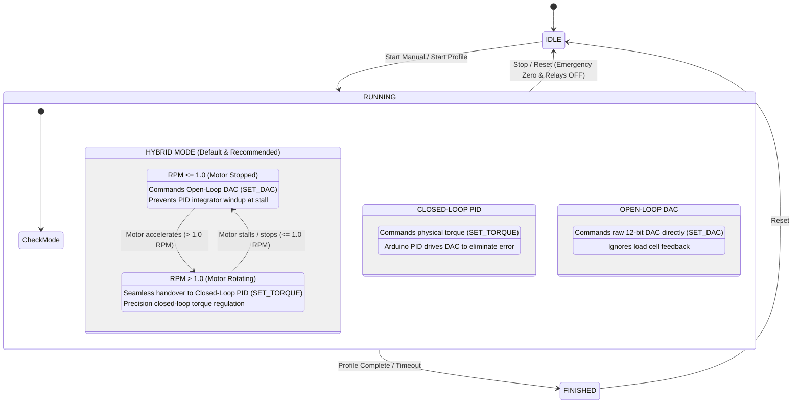
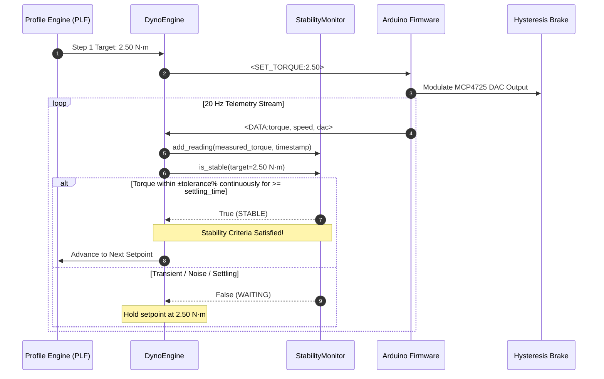

# Motor Dyno Test Bench

[](tests/)
[](https://www.python.org/)
[](README.md)
[](LICENSE)
[](https://github.com/Doron-Shpigel/motor-dyno-test-bench/releases)
[](wiki/Home.md)

A modern, production-grade dynamometer test bench control suite and telemetry framework. Built with **Python 3**, **PyQt6**, **curses**, and **Arduino C++**, it provides closed-loop torque control, continuous steady-state stability gating, multi-interface execution, hardware relay interlocks, and live calibration.

Designed for testing electric motors up to 5.0 N·m with hysteresis brakes, load cells, and digital-to-analog converters.

---

## Highlights & Features



### Three Complementary Interfaces
| Capability | Desktop GUI ([`main.py`](main.py)) | Terminal UI ([`tui.py`](tui.py)) | Python API ([`DynoEngine`](modules/engine.py)) |
| :--- | :---: | :---: | :---: |
| **Target Environment** | Workstation / Desktop (X11 / Wayland / Windows) | Low-spec PCs, Raspberry Pi, SSH terminal | Headless servers, automated test scripts, CI |
| **Framework** | PyQt6 & pyqtgraph | Python `curses` (Zero external dependencies) | Pure Python standard library + numpy |
| **Real-Time Visuals** | 60 FPS strip charts + Dyno Curve ($N\cdot m \text{ vs } RPM$) | ASCII sparkline history chart with auto-scaling | Telemetry callback hooks (`on_telemetry`) |
| **Profile Execution** | Interactive CSV loader + preview table | Single-key `[P]` modal profile loader | `engine.start_profile(path)` |
| **Hardware Relays** | Toggle buttons (Brake, Sensor, Aux) | Hotkeys `[1]`, `[2]`, `[3]` | `engine.set_relay(name, state)` |
| **Control Modes** | Hybrid / Closed-Loop / Open-Loop selector | Hotkey `[O]` cycle | `engine.control_mode = "hybrid"` |
| **Offline Demo Mode**| Simulation toggle | Built-in flag: `--demo` (Simulated physics) | `engine.set_transport(SimulatedTransport())` |

---

## Control Modes Explained

The test bench provides three distinct control modes tailored to electric motor testing:



1. **Hybrid Mode (Recommended)**: Solves the classic dynamometer integrator windup problem. When a motor is stationary ($\text{RPM} \le 1.0$), the system applies open-loop DAC voltage. As soon as the motor spins ($\text{RPM} > 1.0$), it automatically hands over control to the onboard closed-loop PID controller (`<SET_TORQUE:t>`). If the motor stalls, it immediately reverts to DAC mode to prevent current spikes.
2. **Closed-Loop PID Mode**: Directly commands physical target torque in Newton-metres. The microcontroller's internal 20 Hz PID loop continuously modulates the MCP4725 DAC voltage to hold the measured torque at the setpoint.
3. **Open-Loop DAC Mode**: Directly commands raw 12-bit DAC codes ($0 \text{ to } 4095$). Useful for initial sensor calibration, hysteresis brake verification, and manual step testing.

---

## Continuous Stability Monitoring

In automated multi-step profile runs, setpoints must not advance prematurely before physical torque has stabilized:



The [`StabilityMonitor`](modules/stability_monitor.py) evaluates a continuous rolling time window:
$$\text{Lower Bound} = \text{Target} - \max\left(|\text{Target}| \times \frac{\text{Tolerance}\%}{100}, \text{MinAbsTol}\right)$$
$$\text{Upper Bound} = \text{Target} + \max\left(|\text{Target}| \times \frac{\text{Tolerance}\%}{100}, \text{MinAbsTol}\right)$$

Every sample inside the window $[t_{\text{latest}} - t_{\text{settling}}, t_{\text{latest}}]$ must reside strictly within this tolerance band. Telemetry staleness or dropouts ($> 0.5\text{ s}$) instantly invalidate stability.

---

## Hardware Specifications & Wiring

| Component | Model / Part | Description |
| :--- | :--- | :--- |
| **Microcontroller** | Arduino Uno / Nano | Core hardware bridge, 20 Hz PID, 115200 baud USB serial |
| **DAC Module** | MCP4725 / DFR0552 | 12-bit I²C Digital-to-Analog Converter ($0 \text{ to } 4095 \rightarrow 0 \text{ to } 5\text{ V}$) |
| **Torque & Speed Sensor** | FYTH-5-5000-K | 5.0 N·m rated dual-channel sensor (Speed: A0, Torque: A1) |
| **Hysteresis Brake** | HB-750M-2 | 5.0 N·m max braking torque |
| **Power Supply** | 5251-2 | Current-regulated power supply driving brake coil |
| **Hardware Relays** | 3-Channel 5V Relay Board | Relay 1: Brake Power, Relay 2: Sensor Power, Relay 3: Aux |

### Arduino Pinout
* **I²C SDA**: Pin `A4` (Uno/Nano) $\rightarrow$ MCP4725 SDA
* **I²C SCL**: Pin `A5` (Uno/Nano) $\rightarrow$ MCP4725 SCL
* **Speed Sensor Input**: Pin `A0` (Analog RPM pulse/voltage)
* **Torque Sensor Input**: Pin `A1` (Analog load cell voltage)
* **Relay Brake**: Digital Pin `7`
* **Relay Sensor**: Digital Pin `8`
* **Relay Aux**: Digital Pin `9`
* **Status LED**: Pin `13`

---

## Installation & Setup

### Option 1: Standalone Release Archive (Recommended — No Git Required)

You do **not** need Git installed to run the dynamometer software. You can simply download the pre-packaged standalone release:

#### Linux / macOS
1. Download the latest release tarball from [GitHub Releases](https://github.com/Doron-Shpigel/motor-dyno-test-bench/releases) (or via terminal):
   ```bash
   # Download release archive directly
   curl -L -O https://github.com/Doron-Shpigel/motor-dyno-test-bench/releases/download/v2.0.0/motor-dyno-test-bench-v2.0.0-linux.tar.gz

   # Extract archive
   tar -xzf motor-dyno-test-bench-v2.0.0-linux.tar.gz
   cd motor-dyno-test-bench-v2.0.0

   # Run standalone installer (sets up isolated .venv without sudo)
   ./install.sh
   ```

#### Windows
1. Download **`motor-dyno-test-bench-v2.0.0-windows.zip`** from [GitHub Releases](https://github.com/Doron-Shpigel/motor-dyno-test-bench/releases).
2. Right-click the `.zip` file and select **Extract All...**.
3. Open the extracted folder and double-click **`install.bat`** (or run `install.bat` in Command Prompt / PowerShell).
4. The installer automatically detects Python 3.11+, sets up `.venv`, and verifies all dependencies.

---

### Option 2: Clone with Git (For Developers)

If you have `git` installed and want to contribute to the code:

```bash
# Clone the repository (note the exact username: Doron-Shpigel)
git clone https://github.com/Doron-Shpigel/motor-dyno-test-bench.git
cd motor-dyno-test-bench

# Linux / macOS:
chmod +x install.sh
./install.sh

# Windows:
install.bat
```

> **Serial Port Access on Linux**:
> To access USB serial ports without `sudo`, add your user to the `dialout` group:
> ```bash
> sudo usermod -aG dialout $USER
> ```
> *(Log out and back in once for this change to take effect).*

---

## Quickstart Guide

### 1. Launching the Desktop GUI
* **Linux / macOS**: `./run.sh`
* **Windows**: Double-click `run.bat`

Connect your Arduino via USB, select the serial port from the dropdown, click **Connect**, and either adjust manual torque or load a profile CSV.

### 2. Launching the Terminal UI (TUI)
* **Linux / macOS**: `./run_tui.sh`
* **Windows**: Double-click `run_tui.bat`

#### Running in Offline Demo Mode (No Hardware Required)
Test the entire software suite with simulated motor physics and telemetry:
```bash
./run_tui.sh --demo
```

Keybindings in TUI:
* `[C]` Connect / Disconnect port
* `[M]` Start Manual test run
* `[+]` / `[-]` Adjust target torque by $\pm 0.1\text{ N}\cdot\text{m}$
* `[P]` Load and run CSV profile
* `[S]` **STOP / Emergency brake release**
* `[R]` Reset run stats
* `[O]` Cycle control mode (Hybrid $\rightarrow$ Closed-Loop $\rightarrow$ Open-Loop)
* `[1/2/3]` Toggle hardware relays (Brake, Sensor, Aux)
* `[T]` Tune PID gains
* `[K]` Sensor calibration wizard
* `[Q]` Clean shutdown & exit

### 3. Using the Headless Python API
You can automate dynamometer testing directly in Python scripts:

```python
from modules.engine import DynoEngine
from modules.transport import SerialTransport

# Initialize engine
engine = DynoEngine()

# Connect to Arduino
engine.connect("/dev/ttyACM0", baud=115200)

# Listen to real-time telemetry (20 Hz)
engine.on_telemetry = lambda sample: print(
    f"Torque: {sample.torque_nm:5.2f} N·m | Speed: {sample.rpm:4.0f} RPM | DAC: {sample.dac_raw}"
)

# Start automated multi-step profile run
engine.start_profile("assets/load_test_template.csv")

# Keep script alive or run manual tick loop
# engine.stop()
```

### 4. Flashing the Arduino Firmware
1. Open [`arduino/dyno_controller/dyno_controller.ino`](arduino/dyno_controller/dyno_controller.ino) in the Arduino IDE.
2. Select your board (**Arduino Uno** or **Nano**) and the correct serial port.
3. Click **Upload**.
4. The board boots with all relays open and DAC zeroed for safety, emitting `DYNO_READY`.

---

## Serial Protocol Specification

ASCII newline-terminated (`\n`) protocol operating at **115200 baud, 8N1**:

### Inbound Telemetry (Arduino $\rightarrow$ PC)
* `<DATA:t,s,d>`: High-frequency (20 Hz) telemetry packet.
  * `t`: Measured torque sensor reading (ADC counts)
  * `s`: Measured speed sensor reading (ADC counts)
  * `d`: Current 12-bit DAC output value ($0 \text{ to } 4095$)
* `<PID_VALS:p,i,d>`: Transmitted PID gains read from internal EEPROM.
* `ACK:<cmd>`: Command acknowledgment (e.g. `ACK:SET_TORQUE:2.50`).
* `DYNO_READY`: Emitted upon microcontroller boot and I²C DAC initialization.
* `PONG`: Heartbeat response to `PING`.
* `DAC_INIT_ERR:<hex>`: Diagnostic code if the MCP4725 fails I²C initialization.
* `ERR:<msg>`: Firmware error notice.

### Outbound Commands (PC $\rightarrow$ Arduino)
* `<SET_TORQUE:t>`: Set closed-loop target torque in N·m (e.g. `<SET_TORQUE:2.50>`).
* `<SET_DAC:d>`: Set raw 12-bit DAC code ($0 \text{ to } 4095$).
* `<RELAY:name,state>`: Switch relay state (`<RELAY:BRAKE,1>`, `<RELAY:SENSOR,0>`, `<RELAY:AUX,1>`).
* `<SET_PID:p,i,d>`: Tune and write $K_p, K_i, K_d$ gains directly to EEPROM.
* `<GET_PID>`: Request stored PID parameters.
* `START`: Begin high-frequency telemetry streaming.
* `STOP`: Stop streaming, zero DAC output, and release brake.
* `RESET`: Zero DAC, stop stream, and reset firmware registers.
* `PING`: Communication link verification.

---

## Test Suite & Verification

The project includes an exhaustive automated test suite with **149 tests** covering unit, regression, adversarial, stress, and headless UI scenarios:

```bash
# Run the entire test suite
pytest
```

```
============================= test session starts ==============================
rootdir: motor-dyno-test-bench
configfile: pytest.ini
testpaths: tests
collected 149 items

tests/test_adversarial_boundary.py ............                          [  8%]
tests/test_adversarial_closed_loop_stepping.py .......                   [ 12%]
tests/test_adversarial_e2e_stress.py ....                                [ 15%]
tests/test_adversarial_stability_monitor.py .........                    [ 21%]
tests/test_closed_loop_stepping.py ..........                            [ 28%]
tests/test_dyno_engine.py .....................                          [ 42%]
tests/test_e2e_integration.py ...                                        [ 44%]
tests/test_serial_adversarial.py .............                           [ 53%]
tests/test_serial_comm.py ...............                                [ 63%]
tests/test_stability_monitor.py ........................                 [ 79%]
tests/test_tui.py ...............................                        [100%]

============================= 149 passed in 3.22s ==============================
```

---

## Repository Layout

```
.
├── main.py                         # Desktop GUI entry point (PyQt6)
├── tui.py                          # Terminal User Interface entry point (curses)
├── install.sh                      # Standalone Linux installer (zero-sudo)
├── install.bat                     # Standalone Windows installer
├── run.sh                          # Linux GUI launcher
├── run.bat                         # Windows GUI launcher
├── run_tui.sh                      # Linux TUI launcher
├── run_tui.bat                     # Windows TUI launcher
├── requirements.txt                # Python package dependencies
├── environment.yml                 # Optional Conda environment specification
├── pytest.ini                      # Pytest test discovery configuration
├── LICENSE                         # MIT License
├── README.md                       # Main project documentation
│
├── modules/                        # Decoupled Core Backend (Headless API)
│   ├── engine.py                   # DynoEngine: central orchestrator & public API
│   ├── transport.py                # SerialTransport, MockTransport, SimulatedTransport
│   ├── stability_monitor.py        # StabilityMonitor: rolling settling window
│   ├── plf.py                      # PiecewiseLinearFunction: CSV profile interpolator
│   ├── data_model.py               # Thread-safe DynoSession, Sample, RunState, RunMode
│   ├── calibration.py              # CalibrationSettings dataclass
│   ├── csv_logger.py               # Real-time telemetry CSV writer
│   ├── serial_comm.py              # Qt-compatible SerialWorker (QThread bridge)
│   └── tui.py                      # DynoTUI curses dashboard implementation
│
├── gui/                            # PyQt6 Desktop GUI Components
│   ├── main_window.py              # MainWindow orchestrator
│   ├── control_panel.py            # Live telemetry gauges, controls, mode toggles
│   ├── settings_tab.py             # PID tuning, stability parameters & calibration wizard
│   ├── telemetry_tab.py            # Low-level sensor and ADC diagnostics
│   ├── plot_widget.py              # Real-time pyqtgraph dual strip & dyno curve plots
│   ├── csv_import_dialog.py        # CSV torque profile validator & previewer
│   └── serial_config_dialog.py     # Serial port auto-detection dialog
│
├── arduino/                        # Embedded Microcontroller Firmware
│   └── dyno_controller/
│       ├── dyno_controller.ino     # Closed-loop PID & telemetry Arduino sketch
│       └── MCP4725example/         # Custom C++ MCP4725 library & unit test suite
│           └── lib/mcp4725/
│               ├── MCP4725_lib.h   # Fast 12-bit DAC register driver
│               ├── MCP4725_lib.cpp # Implementation
│               └── mock_test/      # C++ host mock tests (Wire.h & Arduino.h mocks)
│
├── assets/                         # Templates & Test Profiles
│   ├── load_test_template.csv      # Stepped multi-setpoint profile (0 to 4.8 N·m)
│   ├── ramp_test_template.csv      # Linear torque ramp profile (0 to 4.5 N·m)
│   └── example_profile.csv         # Standard example profile
│
├── tests/                          # 149 Automated Test Cases
│   ├── test_dyno_engine.py         # Headless Core API unit & integration suite
│   ├── test_tui.py                 # Curses TUI headless mock & prompt tests
│   ├── test_stability_monitor.py   # Stability monitor tolerance & settling tests
│   ├── test_closed_loop_stepping.py# Profile step advancement & timeout gating
│   ├── test_e2e_integration.py     # End-to-end telemetry playback & CSV logging
│   ├── test_serial_comm.py         # Serial worker parsing & command generation
│   ├── test_serial_adversarial.py  # Malformed frame & disconnect resilience
│   ├── test_adversarial_*.py       # Boundary, jitter, chatter & stress suites
│   └── conftest.py
│
├── scripts/                        # Release & Packaging Utilities
│   └── package_release.py          # Release archive generator (.tar.gz and .zip)
│
├── wiki/                           # Complete GitHub Wiki Documentation Suite
│   ├── Home.md                     # Wiki landing page & navigation index
│   ├── Architecture.md             # Detailed system design & concurrency model
│   ├── Core-API-Reference.md       # Full API documentation for all classes
│   ├── GUI-User-Guide.md           # Visual desktop GUI walkthrough & workflows
│   ├── TUI-User-Guide.md           # Terminal UI guide for SSH & low-spec systems
│   ├── Firmware-and-Hardware.md    # Circuit schematics, pinouts, and Arduino code
│   ├── Serial-Protocol-Specification.md # Wire-level protocol rules & framing
│   ├── Installation-and-Troubleshooting.md # Step-by-step setup & FAQ
│   ├── Testing-and-Quality-Assurance.md # Test architecture & verification
│   ├── _Sidebar.md                 # GitHub Wiki sidebar navigation
│   └── _Footer.md                  # GitHub Wiki footer
│
└── .github/workflows/              # GitHub Actions CI/CD
    ├── ci.yml                      # Automated cross-platform test matrix
    └── release.yml                 # Automated release packaging on tag push
```

---

## GitHub Wiki & Detailed Documentation

Comprehensive documentation is available in the [`wiki/`](wiki/Home.md) directory and on the GitHub Wiki:
* [**Architecture & Concurrency**](wiki/Architecture.md): Deep-dive into threading, safety interlocks, and telemetry flow.
* [**Core API Reference**](wiki/Core-API-Reference.md): Complete method and parameter documentation for all classes.
* [**GUI User Guide**](wiki/GUI-User-Guide.md): Visual walkthrough of every dialog, widget, and plot.
* [**TUI User Guide**](wiki/TUI-User-Guide.md): Guide to low-spec and SSH terminal operation.
* [**Firmware & Hardware**](wiki/Firmware-and-Hardware.md): Electrical pinouts, calibration formulas, and C++ driver internals.
* [**Serial Protocol Specification**](wiki/Serial-Protocol-Specification.md): Complete packet syntax and timing diagrams.
* [**Installation & Troubleshooting**](wiki/Installation-and-Troubleshooting.md): Linux dialout guide, Windows setup, and common FAQs.
* [**Testing & Quality Assurance**](wiki/Testing-and-Quality-Assurance.md): Full breakdown of all 149 test cases.

---

## License & Credits

This project is open-source software licensed under the **MIT License** (see [`LICENSE`](LICENSE)).

You are free to use, modify, and distribute the software and firmware for personal, academic, or commercial dyno test benches.

* **Author**: Doron Shpigel  
* **Repository**: [https://github.com/Doron-Shpigel/motor-dyno-test-bench](https://github.com/Doron-Shpigel/motor-dyno-test-bench)
