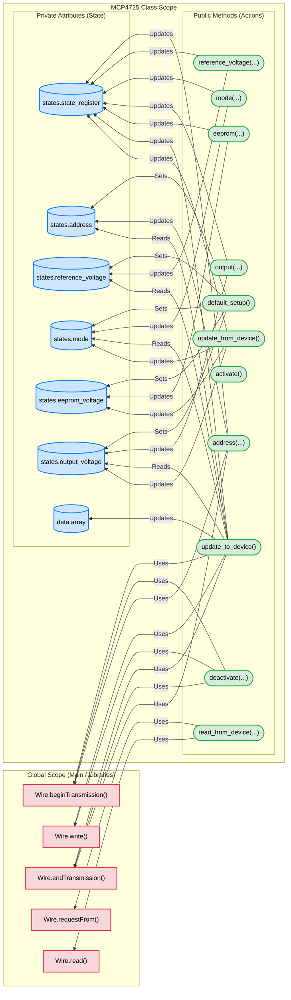

# MCP4725 Arduino Library

A robust, redundant, and highly efficient Arduino library for the MCP4725 12-bit Digital-to-Analog Converter (DAC) with EEPROM.

## Features
- **State Caching**: The class instance caches device states to minimize redundant I2C communications and improve speed.
- **Bitwise Operations**: Optimized bitwise operations are used for high-efficiency register masking and state tracking.
- **Full Configuration**: Easy setup for addressing, normal mode, power-down modes (1kΩ, 100kΩ, 500kΩ), reference voltage, and EEPROM state.
- **Bi-directional Updating**: Read the full configuration and EEPROM settings directly from the device and sync it back to the library instance, or update the device with new settings.

## Architecture

