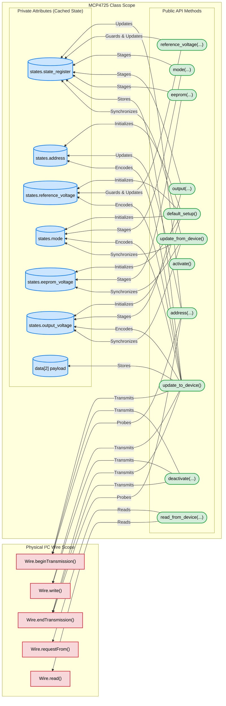

# MCP4725 Arduino Library

A lightweight, robust, and state-caching Arduino C++ library for the **Microchip MCP4725 12-bit Digital-to-Analog Converter (DAC)** with non-volatile EEPROM. Engineered specifically for real-time control applications, including the **motor-dyno-test-bench** hysteresis brake load controller.

---

## Table of Contents
1. [Overview & Key Architectural Features](#overview--key-architectural-features)
2. [Dyno Firmware Integration](#dyno-firmware-integration)
3. [Quickstart Example](#quickstart-example)
4. [Function Reference](#function-reference)
   - [1. `output(uint16_t voltage)`](#1-outputuint16_t-voltage)
   - [2. `update_to_device()`](#2-update_to_device)
   - [3. `default_setup()`](#3-default_setup)
   - [4. `activate()`](#4-activate)
   - [5. `deactivate(uint8_t mode)`](#5-deactivateuint8_t-mode)
   - [6. `eeprom(uint16_t voltage)`](#6-eepromuint16_t-voltage)
   - [7. `value(Prop::type)`](#7-valueproptype)
   - [8. `update_from_device()`](#8-update_from_device)
   - [9. `probe()`](#9-probe)
   - [10. `reference_voltage(uint16_t reference_voltage)`](#10-reference_voltageuint16_t-reference_voltage)
   - [11. `address(a0, a1, a2, device_code)`](#11-addressa0-a1-a2-device_code)
   - [12. `read_from_device(...)`](#12-read_from_device)
   - [13. `mode(uint8_t mode)`](#13-modeuint8_t-mode)
5. [Constants, Enums & Bitfield Definitions](#constants-enums--bitfield-definitions)
6. [C++ Mock Testing & Verification Harness](#c-mock-testing--verification-harness)
7. [Compilation with `arduino-cli`](#compilation-with-arduino-cli)
8. [System Architecture Diagram](#system-architecture-diagram)

---

## Overview & Key Architectural Features

- **State Caching & Staging Pattern**: Public methods such as `output()` and `mode()` stage configuration locally in the object instance. `update_to_device()` commits the staged configuration over I²C in a single transaction, eliminating bus contention and maximizing loop frequency (enables >50 Hz control loops).
- **Physical Voltage & Raw DAC Code Mapping**: Work in millivolts ($0\text{ mV}$ to $5000\text{ mV}$) or configure `reference_voltage(4096)` for a direct 1:1 mapping between 12-bit DAC integer codes ($0\dots 4095$) and library inputs.
- **Non-Volatile EEPROM Protection**: Fast DAC-only register writes (`0x40`) are automatically used by `update_to_device()` unless an EEPROM change was explicitly staged via `eeprom()`. This prevents premature flash memory burnout during high-frequency PID modulation.
- **Hardware Clone Silicon Filter**: Transparently detects and mitigates known read-buffer bugs found on low-cost clone MCP4725 silicon when reading back EEPROM after DAC-only writes.
- **Defensive Error Handling**: Zero division protection across all reference voltage operations, explicit boundary checking on voltage arguments, and power-down mode persistence across activation/deactivation cycles.

---

## Dyno Firmware Integration

In the **motor-dyno-test-bench** firmware (`arduino/dyno_controller/dyno_controller.ino`), the MCP4725 library drives the hysteresis brake via a current-regulated power supply.

```cpp
#include <Wire.h>
#include <MCP4725_lib.h>

MCP4725 dac;

void setup() {
  Wire.begin();
  
  // 1. Initialize MCP4725 at default 0x60 address
  uint8_t dac_err = dac.default_setup();
  if (dac_err == 0) {
    // 2. Set 4096 mV reference for direct 1:1 mapping with 12-bit codes (0-4095)
    dac.reference_voltage(4096);
    // 3. Switch from bootup 1k pull-down to normal active output mode
    dac.activate();
  } else {
    Serial.print(F("DAC_INIT_ERR:0x"));
    Serial.println(dac_err, HEX);
  }

  // Safety: ensure 0 N·m brake torque on boot
  mcp4725_write(0);
}

// High-speed write function invoked at 50 Hz by PID loop
void mcp4725_write(uint16_t value) {
  value = constrain(value, 0, 4095);
  dac.output(value);
  dac.update_to_device();
}
```

---

## Quickstart Example

```cpp
#include <Wire.h>
#include <MCP4725_lib.h>

MCP4725 dac;

void setup() {
  Serial.begin(115200);
  Wire.begin(); // Wire must be initialized before using MCP4725

  // 1. Run default setup (0x60 address, 5V reference, 1k power-down, 0V default)
  uint8_t err = dac.default_setup();
  if (err != 0) {
    Serial.print(F("MCP4725 setup failed! Error: 0x"));
    Serial.println(err, HEX);
    while (1);
  }

  // 2. Activate DAC into normal operating mode
  dac.activate();

  // 3. Set initial voltage to 2500 mV (2.5 V)
  dac.output(2500);
  dac.update_to_device();
}

void loop() {
  // Output a 3.3V signal (3300 mV)
  dac.output(3300);
  dac.update_to_device();
  delay(1000);

  // Output a 1.0V signal (1000 mV)
  dac.output(1000);
  dac.update_to_device();
  delay(1000);
}
```

---

## Function Reference

### 1. `output(uint16_t voltage)`
* **Usage**: Most common runtime method. Updates the target analog output voltage.
* **Signature**: `uint16_t output(uint16_t voltage)`
* **Parameters**: `voltage`: Target output in millivolts ($0$ to $5000\text{ mV}$) or raw 12-bit code if `reference_voltage(4096)` is active.
* **Returns**: `0x0000` on success; `0xFFFF` if `voltage > 5000`.
* **Note**: Stages output locally. Call [`update_to_device()`](#2-update_to_device) to transmit over I²C.

### 2. `update_to_device()`
* **Usage**: Commits staged configuration (voltage, power mode) to the physical MCP4725 over I²C.
* **Signature**: `uint8_t update_to_device()`
* **Returns**:
  - `0x00`: Success.
  - `0x01`: Address not configured or invalid.
  - `0x02`: I²C transmission error (NACK or bus failure).
* **Behavior**: If `eeprom()` was staged, transmits command `0x60` (DAC + EEPROM write). Otherwise, transmits fast command `0x40` (DAC register only) to prevent EEPROM degradation.

### 3. `default_setup()`
* **Usage**: Comprehensive initialization routine executed inside Arduino `setup()`.
* **Signature**: `uint8_t default_setup()`
* **Returns**:
  - `0x00`: Success (device probed at `0x60` and configured).
  - `0x01`: Address invalid or probe failed.
  - `0x02`: Power mode configuration failed.
  - `0x03`: Reference voltage out of range.
  - `0x04`: EEPROM initialization failed.
  - `0x05`: Output initialization failed.
* **Behavior**: Sets 7-bit address to `0x60`, reference voltage to $5000\text{ mV}$, EEPROM to $0\text{ V}$, output to $0\text{ V}$, and initial power-down mode to $1\text{ k}\Omega$. Commits to device and delays $50\text{ ms}$ for EEPROM burn-in.

### 4. `activate()`
* **Usage**: Transitions device from power-down mode to normal operating mode.
* **Signature**: `uint8_t activate()`
* **Returns**:
  - `0x00`: Success.
  - `0x01`: Address not set or probe failed.
  - `0x30`: Device is already in normal (active) mode.

### 5. `deactivate(uint8_t mode)`
* **Usage**: Places the DAC into low-power mode with selectable output pull-down resistance.
* **Signatures**:
  - `uint8_t deactivate(uint8_t mode)`: Powers down with specified pull-down resistance ($1\text{ k}\Omega$, $100\text{ k}\Omega$, or $500\text{ k}\Omega$).
  - `uint8_t deactivate()`: Parameterless variant (restores previously configured power-down mode).
* **Returns**: `0x00` on success; `0x30` if already inactive; error code on bus failure.

### 6. `eeprom(uint16_t voltage)`
* **Usage**: Stores a power-on default output voltage in non-volatile EEPROM.
* **Signature**: `uint16_t eeprom(uint16_t voltage)`
* **Parameters**: `voltage`: Bootup voltage in millivolts ($0$ to $5000\text{ mV}$).
* **Returns**: `0x0000` on success; `0xFFFF` if out of bounds.
* **Note**: Stages the EEPROM write bit. Call `update_to_device()` followed by `delay(50)` to allow the physical flash programming cycle to complete.

### 7. `value(Prop::type)`
* **Usage**: Non-blocking query of cached state attributes without generating I²C traffic.
* **Signatures**:
  - `uint8_t value(Prop::type8 key) const`:
    - `MCP4725::Prop::state`: Raw 8-bit internal status register.
    - `MCP4725::Prop::address`: Configured 7-bit I²C address.
    - `MCP4725::Prop::mode`: Active power mode ($0=\text{Normal}, 1=1\text{k}\Omega, 2=100\text{k}\Omega, 3=500\text{k}\Omega$).
  - `uint16_t value(Prop::type16 key) const`:
    - `MCP4725::Prop::output_voltage`: Cached output voltage in mV.
    - `MCP4725::Prop::eeprom_voltage`: Cached EEPROM voltage in mV.
    - `MCP4725::Prop::reference_voltage`: Configured reference voltage in mV ($5000\text{ mV}$ default).

### 8. `update_from_device()`
* **Usage**: Reads physical register contents over I²C and synchronizes class state.
* **Signature**: `uint8_t update_from_device()`
* **Returns**: `0x00` on success; `0x01` if address is unset; `0x02` if read failed.
* **Behavior**: Requests 5 bytes, decodes DAC and EEPROM voltages, and updates internal properties. Protects against clone silicon read buffer corruption.

### 9. `probe()`
* **Usage**: Verifies hardware presence on the I²C bus.
* **Signature**: `uint8_t probe()`
* **Returns**: `0x00` if ACK received; `0x20` if device fails to acknowledge (NACK).

### 10. `reference_voltage(uint16_t reference_voltage)`
* **Usage**: Configures voltage reference used to convert millivolts to 12-bit register codes ($D = \frac{V_{\text{out}} \times 4096}{V_{\text{ref}}}$).
* **Signature**: `uint16_t reference_voltage(uint16_t reference_voltage)`
* **Parameters**: Reference voltage in mV ($1$ to $5000$). Default is $5000\text{ mV}$. Setting to `4096` enables direct 1:1 mapping with 12-bit DAC codes ($0-4095$).
* **Returns**: `0x0000` on success; `0xFFFF` if $0$ or $>5000$ (prevents divide-by-zero).

### 11. `address(a0, a1, a2, device_code)`
* **Usage**: Configures custom 7-bit I²C address based on pin hardware strapping.
* **Signature**: `uint8_t address(uint8_t address_a0, uint8_t address_a1 = A1, uint8_t address_a2 = A2, uint8_t device_code = 0x60)`
* **Returns**: `0x00` if verified via `probe()`; `0x10`-`0x12` if pin arguments exceed 1; `0x20` if probe fails.

### 12. `read_from_device(...)`
* **Usage**: Low-level diagnostic inspection of raw device registers.
* **Signature**: `uint8_t read_from_device(uint8_t *current_dac_settings, uint16_t *current_dac_register, uint16_t *current_eeprom_register)`

### 13. `mode(uint8_t mode)`
* **Usage**: Stages operating or power-down mode.
* **Signature**: `uint8_t mode(uint8_t mode)`
* **Returns**: `0x00` on success; `0xFF` if invalid mode ($>3$).

---

## Constants, Enums & Bitfield Definitions

```cpp
// Power Down Modes:
MCP4725::power_down_modes::normal_mode         = 0x00; // Active analog output
MCP4725::power_down_modes::power_down_1k_mode   = 0x01; // Output tied to GND via 1k resistor
MCP4725::power_down_modes::power_down_100k_mode = 0x02; // Output tied to GND via 100k resistor
MCP4725::power_down_modes::power_down_500k_mode = 0x03; // Output tied to GND via 500k resistor

// Property Keys (for dac.value(...)):
MCP4725::Prop::state              // 8-bit state register
MCP4725::Prop::address            // Configured 7-bit I2C address
MCP4725::Prop::mode               // Current power mode (0-3)
MCP4725::Prop::reference_voltage  // Reference voltage in mV
MCP4725::Prop::eeprom_voltage     // Stored EEPROM voltage in mV
MCP4725::Prop::output_voltage     // Current output voltage in mV
```

### Internal State Register Bitfield Layout

| Bit | Mask | Meaning | Value = 0 | Value = 1 |
|---|---|---|---|---|
| 0 | `0x01` | Address Set | Address set & probed | Address uninitialized |
| 1 | `0x02` | Mode Set | Mode configured | Mode uninitialized |
| 2 | `0x04` | Reference Set | Reference voltage configured | Reference uninitialized |
| 3 | `0x08` | EEPROM Set | EEPROM staged/set | EEPROM uninitialized |
| 4 | `0x10` | Output Set | Output voltage staged | Output uninitialized |
| 5 | `0x20` | DAC Active | DAC is inactive / powered down | DAC is active in normal mode |
| 6 | `0x40` | Read Corrupted | EEPROM read buffer valid | Read buffer corrupted by DAC write |
| 7 | `0x80` | Verification | Probed & verified responding | Unverified / probe failed |

---

## C++ Mock Testing & Verification Harness

The library includes a complete native C++ unit test suite under `mock_test/` that can be built and run on any Linux, macOS, or Windows host without physical Arduino hardware.

### Mock Harness Structure
- `mock_test/Arduino.h`: Host-level mock providing Arduino standard types, `millis()`, `delay()`, and `constrain()`.
- `mock_test/Wire.h`: Emulated `TwoWire` I²C engine tracking register state, ACK/NACK responses, simulated EEPROM write cycles, and configurable read bus failures.
- `mock_test/MCP4725_lib_test.cpp`: End-to-end integration and method validation suite.
- `mock_test/test_edge_cases.cpp`: Robustness test suite covering:
  1. Default `InternalState` initialization and zero division protection.
  2. Reference voltage boundary constraints ($0\text{ mV}$ and $>5000\text{ mV}$ rejection).
  3. Power-down mode persistence across `activate()` and `deactivate()` cycles.
  4. Voltage boundary enforcement ($5001\text{ mV}$ rejection).
  5. I²C bus read failure handling and error code propagation.

### Executing the Mock Tests
Run from the `mock_test/` directory using standard GCC/Clang:

```bash
cd arduino/dyno_controller/MCP4725example/lib/mcp4725/mock_test
g++ -I. -o /tmp/mcp4725_test test_edge_cases.cpp MCP4725_lib_test.cpp
/tmp/mcp4725_test
```

Expected output:
```
--- Running Edge Case & Robustness Unit Tests ---
[PASS] Default InternalState initialization verified.
[PASS] Reference voltage bounds and div-zero protection verified.
[PASS] Mode persistence and activation/deactivation symmetry verified.
[PASS] Voltage boundary checks verified.
[PASS] I2C read failure error propagation verified.

>>> ALL EDGE CASE & ROBUSTNESS TESTS PASSED! <<<
```

---

## Compilation with `arduino-cli`

When building sketches with `arduino-cli`, supply the library path using `--libraries`:

```bash
# Compile dyno controller sketch for Arduino Uno
arduino-cli compile --fqbn arduino:avr:uno --libraries arduino/dyno_controller/libs arduino/dyno_controller

# Flash to connected board
arduino-cli upload -p /dev/ttyACM0 --fqbn arduino:avr:uno arduino/dyno_controller
```

---

## System Architecture Diagram

