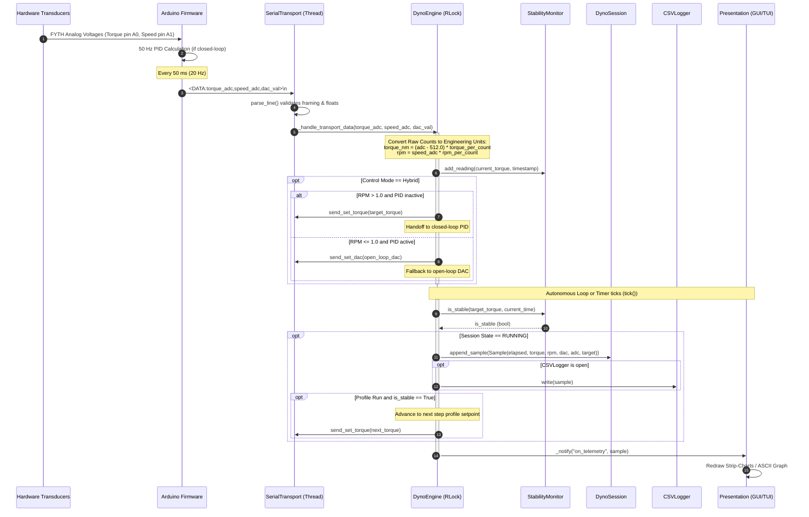
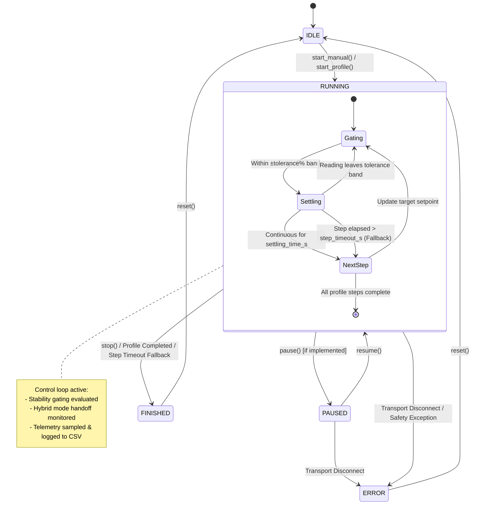

# System Architecture

The **motor-dyno-test-bench** software and hardware ecosystem is organized into a clean, 5-tier layered architecture. Every layer communicates across strictly defined, language-agnostic interfaces. This architecture decouples low-level serial communication, hard real-time PID control, and core profile state management from the presentation layers (GUI, TUI, and automated scripts).

---

## 1. Layered Architectural Model

```mermaid
graph TD
    subgraph Layer5 ["5. Presentation Layer"]
        L5_GUI["PyQt6 Desktop GUI<br/>(main.py / gui/)"]
        L5_TUI["Curses Terminal TUI<br/>(tui.py / modules/tui.py)"]
        L5_API["Automated Python Scripts / Notebooks"]
    end

    subgraph Layer4 ["4. Core Engine Layer"]
        L4_ENG["DynoEngine<br/>(Thread-Safe Orchestrator & RLock)"]
        L4_PLF["PiecewiseLinearFunction<br/>(Profile Interpolator)"]
        L4_STAB["StabilityMonitor<br/>(Settling Time Gating)"]
        L4_SESS["DynoSession<br/>(Sample Model & Snapshot Provider)"]
        L4_LOG["CSVLogger<br/>(Auto-Timestamped CSV Streaming)"]
        L4_CAL["CalibrationSettings<br/>(Scale Factors & Constants)"]
    end

    subgraph Layer3 ["3. Transport Layer"]
        L3_BASE["BaseTransport<br/>(Abstract Protocol & Line Parser)"]
        L3_SER["SerialTransport<br/>(Background Thread & Non-blocking Queue)"]
        L3_SIM["SimulatedTransport<br/>(Physics & Dynamics Engine)"]
        L3_MOCK["MockTransport<br/>(In-Memory Test Double)"]
    end

    subgraph Layer2 ["2. Embedded Firmware Layer"]
        L2_INO["Arduino Controller Firmware<br/>(dyno_controller.ino)"]
        L2_PID["50 Hz Hardware PID Loop<br/>(Anti-Windup Clamped)"]
        L2_TEL["20 Hz Telemetry Streamer<br/>(&lt;DATA:t,s,d&gt;)"]
        L2_MEM["EEPROM Parameter Storage<br/>(Persistent Kp, Ki, Kd)"]
        L2_LIB["MCP4725 C++ Library<br/>(Fast Direct I²C Register Writes)"]
    end

    subgraph Layer1 ["1. Physical Hardware Layer"]
        L1_BRAKE["HB-750M-2 Hysteresis Brake<br/>(0–5 N·m Absorber)"]
        L1_SENSOR["FYTH-5-5000-K Transducer<br/>(Strain Gauge + Optical Encoder)"]
        L1_DAC["MCP4725 12-Bit DAC Module<br/>(I²C Address 0x60)"]
        L1_PSU["5251-2 Constant Current Power Supply"]
        L1_RELAYS["Optoisolated Relay Board<br/>(Brake, Sensor, Aux)"]
        L1_DUT["Device Under Test (Motor)"]
    end

    L5_GUI --> L4_ENG
    L5_TUI --> L4_ENG
    L5_API --> L4_ENG

    L4_ENG --> L4_PLF
    L4_ENG --> L4_STAB
    L4_ENG --> L4_SESS
    L4_ENG --> L4_LOG
    L4_ENG --> L4_CAL
    L4_ENG --> L3_BASE

    L3_BASE <|-- L3_SER
    L3_BASE <|-- L3_SIM
    L3_BASE <|-- L3_MOCK

    L3_SER <==>|USB Serial @ 115200 8N1| L2_INO
    L2_INO --> L2_PID
    L2_INO --> L2_TEL
    L2_INO --> L2_MEM
    L2_INO --> L2_LIB

    L2_LIB -->|I²C Fast Mode| L1_DAC
    L2_INO -->|Digital I/O D2-D4| L1_RELAYS
    L1_DAC -->|0–5V Analog Signal| L1_PSU
    L1_PSU -->|Current Control 0–1.5A| L1_BRAKE
    L1_DUT -.->|Mechanical Shaft| L1_SENSOR
    L1_DUT -.->|Mechanical Shaft| L1_BRAKE
    L1_SENSOR -->|Analog Output A0/A1| L2_INO
```

---

## 2. Layer-by-Layer Breakdown

### Layer 1: Hardware Layer
The physical test bench comprises:
- **HB-750M-2 Hysteresis Brake**: Produces smooth, frictionless magnetic drag torque up to $5\text{ N}\cdot\text{m}$. Unlike friction or eddy-current brakes, hysteresis brakes maintain full torque capacity down to zero RPM (stall condition).
- **FYTH-5-5000-K Torque & Speed Transducer**: Integrated dual-function unit. The torque transducer uses a full-bridge strain gauge providing an analog voltage centered at $2.5\text{ V}$ ($512$ counts), scaling bi-directionally. The speed transducer outputs an analog signal proportional to shaft rotational speed ($0$ to $5000\text{ RPM}$).
- **Microchip MCP4725 12-Bit DAC**: Connected to the microcontroller via I²C at address `0x60`. Outputs high-resolution control voltages ($0$ to $5\text{ V}$, $4096$ steps).
- **Current-Regulated Power Supply**: Converts the DAC voltage into precise current excitation through the brake's coil.
- **Relay Board**: Solid-state and electromagnetic relays controlling main brake power, sensor excitation, and auxiliary bench hardware.

### Layer 2: Embedded Firmware Layer
Residing on the Arduino Uno/Nano (`arduino/dyno_controller/dyno_controller.ino`):
- **50 Hz Control Loop ($20\text{ ms}$ interval)**: Executes closed-loop PID control when enabled. Computes proportional, integral (with anti-windup clamping to $\pm 4000$), and derivative terms, generating direct 12-bit DAC commands.
- **20 Hz Telemetry Streaming ($50\text{ ms}$ interval)**: Continuously emits structured telemetry packets (`<DATA:torque_adc,speed_adc,dac_val>`).
- **EEPROM Storage**: Preserves PID tuning parameters ($K_p, K_i, K_d$) in non-volatile memory across power cycles.
- **MCP4725 C++ Library**: Implements direct register caching and fast DAC writes (`0x40`) without triggering EEPROM write cycles.

### Layer 3: Transport Layer
Decoupled entirely from GUI frameworks (`modules/transport.py`):
- **`BaseTransport`**: Abstract interface defining event callbacks (`on_data`, `on_pid`, `on_ack`, `on_ready`, `on_error`, `on_connected`, `on_disconnected`) and concrete command formatters (`send_set_torque`, `send_set_dac`, `send_relay`). Includes a robust line parser handling malformed or fragmented packets.
- **`SerialTransport`**: Executes in a dedicated background `threading.Thread`. Transmits outbound commands via a thread-safe `queue.Queue` and receives inbound serial lines without blocking the main engine loop.
- **`SimulatedTransport`**: A motor physics simulation model mimicking motor inertia, RPM droop under load, closed-loop torque settling, and sensor noise. Enables full GUI and TUI testing without physical hardware.
- **`MockTransport`**: In-memory test double supporting programmatic test assertions and deterministic scenario replay.

### Layer 4: Core Engine Layer
The brain of the test bench (`modules/engine.py`):
- **`DynoEngine`**: Orchestrates state transitions, execution modes (Hybrid, Open-Loop, Closed-Loop), automated step profiles, manual torque adjustments, relay safety shutoff, and calibration routines.
- **`StabilityMonitor`**: Detects steady-state settling by maintaining a sliding-window time-history of torque samples. Gating ensures profile steps advance only when torque has settled within $\pm\text{tolerance}\%$ for at least $\text{settling\_time\_s}$ seconds.
- **`DynoSession`**: Thread-safe sample storage holding complete test history. Provides immutable snapshots for plotting and logging.
- **`PiecewiseLinearFunction`**: Interpolates CSV torque-versus-time profile files.
- **`CSVLogger`**: Streams timestamped sample rows directly to disk.

### Layer 5: Presentation Layer
- **PyQt6 Desktop GUI (`gui/`)**: Multi-threaded GUI with high-framerate OpenGL strip-charts (pyqtgraph), interactive control panels, Settings tabs, and CSV preview importers.
- **Curses Terminal TUI (`modules/tui.py`)**: Lightweight terminal dashboard with real-time ASCII torque history chart, dynamic Y-axis scaling, and keyboard controls.
- **Python Automation Scripts**: Direct programmatic scripting via `DynoEngine` API.

---

## 3. Concurrency and Thread Safety Model

Real-time dynamometer control demands strict concurrency guarantees: telemetry arrives at 20 Hz, the control loop ticks at 10–50 Hz, and user inputs or UI repaints happen asynchronously.

```mermaid
flowchart TD
    subgraph SerialThread ["Serial Transport Thread"]
        RX["Serial Read Loop (readline)"]
        TXQ["Outbound Queue (queue.Queue)"]
        TX["Serial Write (write)"]
    end

    subgraph EngineLock ["DynoEngine Synchronization Domain (threading.RLock)"]
        ENG_STATE["Engine State Machine<br/>(RunState, RunMode)"]
        CALIB_STATE["Calibration Readings"]
        STAB_MON["StabilityMonitor Buffer"]
        STEP_TIMER["Step Timeout & Index Tracker"]
    end

    subgraph SessionLock ["DynoSession Synchronization Domain (threading.Lock)"]
        SAMPLES["Sample List (_samples: List[Sample])"]
    end

    subgraph UIThread ["Presentation / Timer Thread"]
        TICK["engine.tick() or Autonomous Loop"]
        EVENT_DISPATCH["Event Listeners (_notify)"]
        PLOT_UPDATE["Plot Widget Redraw"]
    end

    RX -->|parse_line()| ENG_STATE
    RX -->|add_reading()| STAB_MON
    TICK -->|Guarded by RLock| ENG_STATE
    TICK -->|Evaluate Stability| STAB_MON
    TICK -->|Append Sample| SAMPLES
    SAMPLES -->|get_snapshot() copy| PLOT_UPDATE
    ENG_STATE -->|put command| TXQ
    TXQ --> TX
    TICK -->|Dispatch callbacks| EVENT_DISPATCH
```

### Key Concurrency Principles
1. **Engine Reentrant Lock (`threading.RLock`)**:  
   All internal state modifications in `DynoEngine`—including mode transitions, setpoint updates, relay switches, and tick evaluations—are protected by a single reentrant lock (`self._lock`). This allows public engine methods to call internal helper methods safely without deadlocking.
2. **Transport Decoupling (`queue.Queue`)**:  
   Outbound commands (`START`, `<SET_TORQUE:x>`, `<RELAY:...>`) are placed into a non-blocking queue (`queue.Queue`). The serial thread drains this queue asynchronously, ensuring user interface actions never experience serial I/O latency.
3. **Thread-Safe Session Data Model (`DynoSession`)**:  
   Telemetry samples are stored in `DynoSession`, which protects its internal list with an independent `threading.Lock`. Readers can call `get_snapshot()` to receive a shallow copy of the sample buffer, allowing plot rendering or CSV flushing to proceed concurrently without lock contention.
4. **Isolated Event Notification**:  
   The `_notify()` dispatcher invokes user-registered callbacks inside individual `try...except` blocks. If an external listener (such as a plotting widget) raises an unhandled exception, it is caught and routed to `on_error` without terminating the control loop or corrupting engine state.

---

## 4. Real-Time Telemetry Pipeline

The telemetry pipeline processes raw physical sensor counts into calibrated engineering units, records the data, evaluates steady-state stability, and drives real-time displays.



### Telemetry Pipeline Conversion Mathematics
1. **Torque Transducer**:
   $$\tau = (\text{ADC}_{\text{torque}} - 512.0) \times K_{\tau}$$
   Where $K_{\tau} = \frac{5.0}{\text{peak\_adc} - 512.0}$ (default $K_{\tau} \approx \frac{5.0}{511.0} \approx 0.009785\text{ N}\cdot\text{m/count}$).
2. **Speed Transducer**:
   $$\text{RPM} = \text{ADC}_{\text{speed}} \times K_{\text{rpm}}$$
   Where $K_{\text{rpm}} = 0.5\text{ RPM/count}$ (configurable via `CalibrationSettings`).
3. **Open-Loop DAC Output**:
   $$\text{DAC} = \text{clamp}\left(\left\lfloor \frac{\tau_{\text{target}}}{\tau_{\text{max}}} \times 4095 \right\rceil, 0, 4095\right)$$

---

## 5. Control Loop State Machine

The core lifecycle of a dynamometer run transitions through explicit states:



### State Definitions
- **`IDLE`**: Initial ready state. DAC is set to 0, relays are in user-commanded state, session buffer is empty.
- **`RUNNING`**: Test is actively underway. Telemetry is being recorded to `DynoSession` and streamed to `CSVLogger`. Control loop evaluates stability gating every tick.
- **`PAUSED`**: Intermediate state holding current setpoint without advancing profile steps.
- **`FINISHED`**: Normal test completion or operator stop. DAC is zeroed, all hardware relays are opened for safety, and the CSV log file is flushed and closed.
- **`ERROR`**: Abnormal termination triggered by a hardware fault, serial disconnection, or malformed emergency frame. Relays open instantly and DAC is zeroed.
