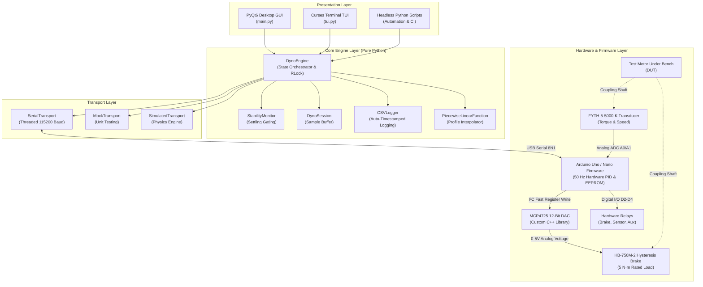

# Motor Dyno Test Bench — Documentation Hub

Welcome to the official technical documentation and engineering reference for the **motor-dyno-test-bench** project.

The **motor-dyno-test-bench** is an open-source, publication-grade motor dynamometer control and data acquisition system designed for electric motor characterization (BLDC, DC, and stepper motors). It provides high-precision load absorption up to $5\text{ N}\cdot\text{m}$ using an electromagnetic hysteresis brake, automated torque-profile stepping, real-time telemetry streaming at 50 Hz, and dual user interfaces: a desktop GUI built with **PyQt6** and **pyqtgraph**, and a lightweight Terminal User Interface (TUI) built with pure Python **curses** for headless Linux and Raspberry Pi deployments.

---

## High-Level System Architecture



---

## Feature Matrix: GUI vs. TUI vs. Core API

The project is structured with strict architectural decoupling. The core engine and transports contain zero GUI dependencies, allowing identical control algorithms and stability monitors to run across all operational modes.

| Capability / Feature | PyQt6 Desktop GUI (`main.py`) | Curses Terminal TUI (`tui.py`) | Headless Core API (`DynoEngine`) |
|---|:---:|:---:|:---:|
| **Target Environment** | Workstations, Lab PCs (X11/Wayland/Windows) | Raspberry Pi, SSH Terminals, Headless Servers | Automation scripts, CI/CD, Jupyter notebooks |
| **Graphical Dependencies** | PyQt6, pyqtgraph, OpenGL | Standard library `curses` (Zero GUI deps) | Pure Python, NumPy (Zero GUI deps) |
| **Control Modes** | Hybrid, Closed-Loop PID, Open-Loop DAC | Hybrid, Closed-Loop PID, Open-Loop DAC | Hybrid, Closed-Loop PID, Open-Loop DAC |
| **Hardware Relays** | UI Toggle Buttons (Brake, Sensor, Aux) | Keyboard toggles `[1]`, `[2]`, `[3]` | `set_relay(name, state)` |
| **Torque Profile Execution** | Visual CSV preview dialog & status bar | Interactive file prompt `[P]` | `start_profile(path_or_plf)` |
| **Real-Time Visualizations** | Dual OpenGL strip-charts & XY dyno curve | Dynamic ASCII oscilloscope sparkline | Callback streaming (`on_telemetry`) |
| **PID Parameter Tuning** | Dedicated Settings Tab with EEPROM Read/Write | Interactive prompt `[T]` | `get_pid()`, `set_pid(p, i, d)` |
| **Torque Calibration Wizard** | Guided 2-step peak force calibration wizard | Interactive wizard toggle `[K]` | `start_calibration()`, `finish_calibration()` |
| **Manual Torque Setpoints** | Retention spinbox & interactive slider | Real-time `[+]` / `[-]` micro-stepping & `[M]` | `set_manual_torque(nm)` |
| **Telemetry CSV Logging** | Auto-timestamped log with manual save button | Interactive logging toggle `[L]` | `start_logging()`, `stop_logging()` |
| **Simulation / Demo Mode** | N/A (Hardware connection) | Flag `--demo` / `--mock` (Physics engine) | Built-in `SimulatedTransport` |

---

## Wiki Table of Contents

Navigate the documentation suite using the links below or through the sidebar:

1. **[System Architecture](Architecture.md)**  
   Layered system design, thread-safety concurrency model (`RLock`, worker queues), real-time telemetry pipeline, and state machines.
2. **[Core API Reference](Core-API-Reference.md)**  
   Exhaustive technical documentation of `DynoEngine`, `BaseTransport`, `SerialTransport`, `SimulatedTransport`, `StabilityMonitor`, `PiecewiseLinearFunction`, `CSVLogger`, and `DynoSession`.
3. **[GUI User Guide](GUI-User-Guide.md)**  
   Walkthrough of the desktop PyQt6 interface: control panels, profile loading, real-time dual strip-charts, dyno curve generation, and calibration wizards.
4. **[TUI User Guide](TUI-User-Guide.md)**  
   Comprehensive guide to the curses-based console interface: keyboard controls cheat-sheet, ASCII graph scaling, SSH execution, and demonstration mode.
5. **[Firmware & Hardware Guide](Firmware-and-Hardware.md)**  
   Hardware specifications (hysteresis brake, FYTH sensor, MCP4725 DAC), complete electrical pinouts, Arduino firmware architecture, and calibration formulas.
6. **[Serial Protocol Specification](Serial-Protocol-Specification.md)**  
   Line-level protocol definition (115200 baud, 8N1), packet structures (`<DATA>`, `<SET_TORQUE>`, `<RELAY>`), timeout rules, and validation mechanisms.
7. **[Installation & Troubleshooting](Installation-and-Troubleshooting.md)**  
   Step-by-step installation instructions for Linux and Windows, serial port permissions (`dialout`), dependency matrices, and diagnostic runbooks.
8. **[Testing & Quality Assurance](Testing-and-Quality-Assurance.md)**  
   Overview of the 149-test automated test suite, adversarial testing strategies, simulation physics validation, and instructions for running `pytest`.

---

## Quick Start Cheat-Sheet

### Desktop GUI (Windows / Linux)
```bash
# Linux / macOS
chmod +x run.sh && ./run.sh

# Windows
run.bat
```

### Terminal Interface (Raspberry Pi / Remote SSH)
```bash
# Launch interactive TUI connected to USB serial
./run_tui.sh --port /dev/ttyUSB0

# Launch standalone demonstration mode (no hardware required)
./run_tui.sh --demo
```

### Headless Python Script
```python
from modules.engine import DynoEngine
from modules.transport import SimulatedTransport

# Initialize engine with realistic motor physics simulation
engine = DynoEngine(transport=SimulatedTransport())
engine.connect()

# Run a manual torque step at 2.5 N·m
engine.start_manual(target_torque=2.5, mode="hybrid")

# Tick control loop or run autonomously
engine.start_loop()
```
