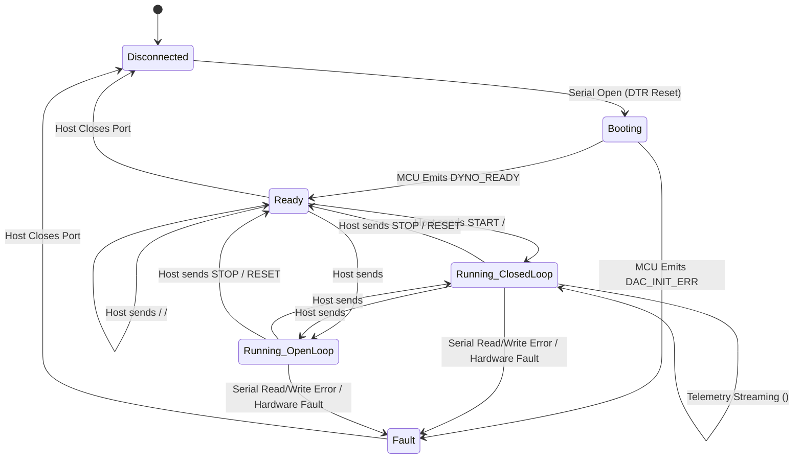

# Serial Protocol Specification

This document defines the physical layer, packet framing, syntax specifications, timing constraints, and error recovery sequences for communication between the host PC application and the Arduino microcontroller over USB serial.

---

## 1. Physical Layer Parameters

| Parameter | Value |
|---|---|
| **Baud Rate** | `115200` baud |
| **Data Bits** | 8 |
| **Parity** | None (`N`) |
| **Stop Bits** | 1 (`8N1`) |
| **Flow Control** | None (Software/Hardware flow control disabled) |
| **Line Termination** | Outbound: ASCII Line Feed (`\n` / `0x0A`). Inbound: Accepts `\n` or `\r\n`. |
| **Encoding** | Standard ASCII (7-bit UTF-8 compatible) |

---

## 2. Inbound Telemetry Packets (Microcontroller $\rightarrow$ Host PC)

Inbound packets are emitted autonomously by the firmware loop or sent as acknowledgments to host commands.

| Packet Identifier | Structure & Format | Frequency | Description | Example |
|---|---|:---:|---|---|
| **`DATA`** | `<DATA:torque_adc,speed_adc,dac_val>` | 20 Hz ($50\text{ ms}$) | Live telemetry payload containing raw torque ADC ($0-1023$), speed ADC ($0-1023$), and active DAC command ($0-4095$). | `<DATA:512.00,0.00,0>`<br/>`<DATA:721.45,550.00,2048>` |
| **`PID_VALS`** | `<PID_VALS:Kp,Ki,Kd>` | On Request | Transmits active PID gains stored in ATmega EEPROM in response to `<GET_PID>`. Format is 4-decimal floating point. | `<PID_VALS:100.0000,10.0000,1.0000>` |
| **`ACK`** | `ACK:<command_payload>` | On Command | Confirms receipt and execution of outbound host commands. | `ACK:START`<br/>`ACK:SET_TORQUE:2.50`<br/>`ACK:SET_PID`<br/>`ACK:RELAY:BRAKE,1` |
| **`PONG`** | `PONG` | On Command | Response to host `PING` connectivity heartbeat. | `PONG` |
| **`DYNO_READY`** | `DYNO_READY` | Once at Boot | Transmitted immediately after Arduino completes `setup()` (EEPROM verified, DAC initialized to 0, relays opened). | `DYNO_READY` |
| **`ERR`** | `ERR:<message>` | Asynchronous | Reports runtime hardware or software fault on the microcontroller. | `ERR:EEPROM_CORRUPT`<br/>`ERR:INVALID_COMMAND` |
| **`DAC_INIT_ERR`** | `DAC_INIT_ERR:<hex_code>` | Once at Boot | Emitted if the MCP4725 DAC fails I²C probing or configuration during setup. | `DAC_INIT_ERR:0x01`<br/>`DAC_INIT_ERR:0x20` |
| **`SPEED`** | `SPEED:<raw_adc>` | Legacy | Backward-compatible speed packet parsed by host transport. | `SPEED:540` |

---

## 3. Outbound Command Packets (Host PC $\rightarrow$ Microcontroller)

Outbound commands configure run states, setpoints, hardware relays, and tuning parameters.

| Command | Format | Expected Response | Description | Example |
|---|---|---|---|---|
| **`START`** | `START\n` | `ACK:START` | Initiates closed-loop PID control and activates load application. | `START` |
| **`STOP`** | `STOP\n` | `ACK:STOP` | Safely disengages closed-loop control, zeroes DAC output ($0\text{ V}$), and opens relays. | `STOP` |
| **`RESET`** | `RESET\n` | `ACK:RESET` | Resets microcontroller state, zeroes DAC output, and clears error integral history. | `RESET` |
| **`PING`** | `PING\n` | `PONG` | Verifies serial link integrity and latency. | `PING` |
| **`<GET_PID>`** | `<GET_PID>\n` | `<PID_VALS:p,i,d>` | Queries active PID tuning gains from EEPROM memory. | `<GET_PID>` |
| **`<SET_PID>`** | `<SET_PID:Kp,Ki,Kd>\n` | `ACK:SET_PID` | Writes new PID parameters to EEPROM address 0. Re-zeros integral accumulator. | `<SET_PID:120.0000,15.5000,1.2000>` |
| **`<SET_TORQUE>`** | `<SET_TORQUE:target_nm>\n` | `ACK:SET_TORQUE:<val>` | Sets closed-loop torque setpoint in $\text{N}\cdot\text{m}$. Enables PID loop. | `<SET_TORQUE:2.50>` |
| **`<SET_DAC>`** | `<SET_DAC:dac_val>\n` | `ACK:SET_DAC:<val>` | Commands raw 12-bit DAC output ($0-4095$) in open-loop mode. Disables PID loop. | `<SET_DAC:2048>` |
| **`<RELAY>`** | `<RELAY:NAME,STATE>\n` | `ACK:RELAY:NAME,STATE` | Switches hardware relay. `NAME` is `BRAKE`, `SENSOR`, or `AUX`; `STATE` is `1` (ON) or `0` (OFF). | `<RELAY:BRAKE,1>`<br/>`<RELAY:SENSOR,0>` |

---

## 4. Protocol State Machine



---

## 5. Packet Framing, Validation & Error Handling

### 1. Delimiter Enforcement
- Enclosing Angle Brackets: All structured command and telemetry frames (except standalone keywords like `START`, `STOP`, `RESET`, `PING`, `PONG`, `DYNO_READY`) must begin with `<` and end with `>`.
- Packets missing closing brackets are rejected by `BaseTransport.parse_line()`, generating an `on_error` notification:
  ```
  Malformed DATA frame: <DATA:512,200 (missing closing '>')
  ```

### 2. Numeric Validation
- Every floating-point and integer field in `<DATA:t,s,d>` and `<PID_VALS:p,i,d>` is parsed using `float()` and checked with `math.isfinite()`.
- If an ADC count or gain value contains `NaN`, `Inf`, or unparseable ASCII noise, the packet is safely dropped without crashing the transport thread.

### 3. Microcontroller DTR Reset Window
- When a host opens a serial connection to an Arduino Uno/Nano, the USB-to-UART chip (ATmega16U2 or CH340) asserts DTR, causing an automatic hardware reset of the microcontroller.
- `SerialTransport` implements an automatic non-blocking boot delay of **2.0 seconds** (`boot_delay=2.0`), buffering any preliminary commands until the microcontroller's bootloader completes and executes `setup()`.

### 4. Communication Failure Recovery
- **Write Timeout Handling:** If an outbound command cannot be written within $1.0\text{ s}$ (`write_timeout=1.0`), `SerialTransport` flags a write error and dispatches `on_error`.
- **Read Timeout Handling:** Serial read operates with a $50\text{ ms}$ non-blocking timeout (`read_timeout=0.05`). If no bytes are received, the loop iterates, checking outbound queues and stop requests.
- **Auto-Safe Disconnect:** When `SerialTransport` disconnects or detects an unrecoverable I/O exception, it attempts to emit `RESET\n` before closing the port descriptor.
