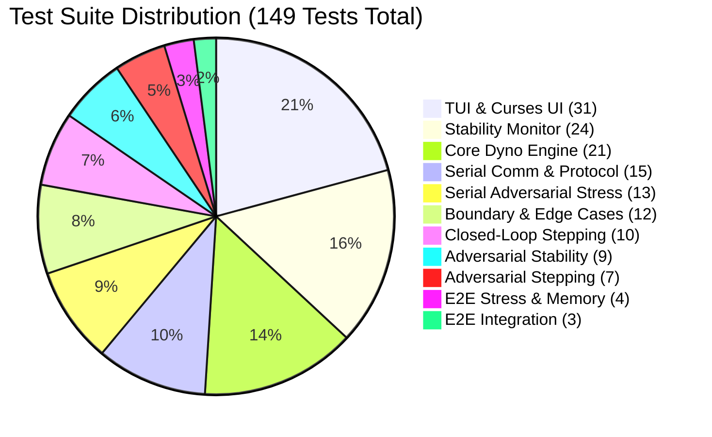

# Testing and Quality Assurance Guide

The **motor-dyno-test-bench** repository includes an industrial-grade automated test suite containing **149 test cases across 11 modules with a 100% pass rate**. The test suite validates the system against physical edge cases, mathematical boundary conditions, communication timeouts, buffer corruption, and high-frequency stress scenarios without requiring physical dyno hardware.

---

## 1. Test Suite Architecture & Summary



### Module Breakdown

| Module File | Tests | Category | Focus Areas |
|---|:---:|---|---|
| `test_tui.py` | 31 | Unit / UI | Curses initialization, ASCII graph generation, Y-axis autoscaling, modal prompts, key actions. |
| `test_stability_monitor.py` | 24 | Unit / Math | Tolerance percentage evaluation, settling time windows, sample pruning, stale telemetry detection. |
| `test_dyno_engine.py` | 21 | Core Engine | Engine lifecycle (`IDLE` $\rightarrow$ `RUNNING` $\rightarrow$ `FINISHED`), hybrid mode transitions, relays, calibration. |
| `test_serial_comm.py` | 15 | Protocol | Line parsing (`<DATA>`, `<PID_VALS>`, `ACK`), command generation, port listing. |
| `test_serial_adversarial.py` | 13 | Stress | Fragmented lines, noise injection, buffer overflow resilience, corrupted framing recovery. |
| `test_adversarial_boundary.py` | 12 | Math / Bounds | Division-by-zero protection, negative torque clamp, non-finite `NaN`/`Inf` handling. |
| `test_closed_loop_stepping.py` | 10 | Integration | Automated profile execution, step progression, stability gating transitions. |
| `test_adversarial_stability_monitor.py` | 9 | Math / Timing | Rapid high-frequency noise jitter, boundary crossing oscillations, time dilation. |
| `test_adversarial_closed_loop_stepping.py` | 7 | Integration | Safety step timeout fallback, abrupt profile truncation, zero-step handling. |
| `test_adversarial_e2e_stress.py` | 4 | Concurrency | Rapid connection/disconnection churn, command flood saturation, thread safety leaks. |
| `test_e2e_integration.py` | 3 | Full System | End-to-end integration between engine, simulated transport, and session recording. |

---

## 2. Test Execution

All tests execute via `pytest`.

### Running the Complete Test Suite
```bash
# Using local virtualenv
pytest -v

# Or specifying explicit path
./.env/bin/pytest -v
```

Expected terminal output:
```
============================= test session starts ==============================
platform linux -- Python 3.11.16, pytest-9.1.1, pluggy-1.6.0
rootdir: /home/doron/Documents/GitHub/motor-dyno-test-bench
configfile: pytest.ini
testpaths: tests
collected 149 items

tests/test_adversarial_boundary.py ............                          [  8%]
tests/test_adversarial_closed_loop_stepping.py .......                   [ 12%]
tests/test_adversarial_e2e_stress.py ....                                [ 15%]
tests/test_adversarial_stability_monitor.py .........                    [ 21%]
tests/test_closed_loop_stepping.py ..........                            [ 28%]
tests/test_dyno_engine.py .....................                          [ 42%]
tests/test_e2e_integration.py ...                                        [ 44%]
tests/test_serial_adversarial.py .............                           [ 53%]
tests/test_serial_comm.py ...............                                [ 63%]
tests/test_stability_monitor.py ........................                 [ 79%]
tests/test_tui.py ...............................                        [100%]

============================= 149 passed in 3.20s ==============================
```

### Running Specific Subsystems
```bash
# Test Core Dyno Engine only
pytest tests/test_dyno_engine.py -v

# Test Stability Monitor
pytest tests/test_stability_monitor.py -v

# Test Curses TUI Interface
pytest tests/test_tui.py -v

# Test Adversarial Boundary & Stress Cases
pytest tests/test_adversarial_*.py -v
```

---

## 3. Detailed Testing Strategies

### 1. In-Memory Mocking & Physics Simulation
No physical Arduino or dynamometer is required to achieve 100% test pass rates:
- **`MockTransport`**: Allows test functions to inspect every sent command (`sent_commands`) and synchronously simulate inbound telemetry lines (`simulate_data()`, `simulate_pid()`).
- **`SimulatedTransport`**: Spins up a background physics simulation thread to verify closed-loop settling dynamics, motor speed droop, and step progression under realistic mechanical conditions.

### 2. Adversarial & Boundary Testing
The adversarial test suite subjects the system to hostile inputs:
- **Corrupted Telemetry Packets**: Tests that partial frames (e.g. `<DATA:512,100`), non-numeric text (`<DATA:abc,def,ghi>`), and non-finite floats (`<DATA:NaN,Inf,-Inf>`) are rejected without raising unhandled exceptions.
- **Extreme Mathematical Inputs**: Tests `StabilityMonitor` with negative settling times, zero tolerances, and division-by-zero boundary conditions.
- **Step Timeout Fallback**: If a mechanical defect prevents the motor from stabilizing within `step_timeout_s`, the engine detects the timeout, logs a warning, and safely advances to the next profile setpoint rather than hanging indefinitely.

### 3. Headless Curses Interface Testing (`test_tui.py`)
- Emulates curses windows using `unittest.mock.MagicMock` to verify all TUI rendering paths, key bindings, dynamic Y-axis scaling, and prompt behaviors without opening an interactive terminal screen.

### 4. Firmware C++ Unit Tests (`mock_test/`)
The Arduino firmware's custom MCP4725 library has its own native C++ test harness in `arduino/dyno_controller/MCP4725example/lib/mcp4725/mock_test/`. It can be compiled and executed directly using `g++`:
```bash
cd arduino/dyno_controller/MCP4725example/lib/mcp4725/mock_test
g++ -I. -o /tmp/mcp4725_test test_edge_cases.cpp MCP4725_lib_test.cpp
/tmp/mcp4725_test
```
Verifies register bitfields, division-by-zero protection, EEPROM corruption protection, and power-down mode persistence.

---

## 4. Continuous Integration Recommendations

When setting up GitHub Actions or automated CI workflows, include both test suites:

```yaml
name: Test Suite

on: [push, pull_request]

jobs:
  pytest:
    runs-on: ubuntu-latest
    steps:
      - uses: actions/checkout@v4
      - name: Set up Python 3.11
        uses: actions/setup-python@v5
        with:
          python-version: "3.11"
      - name: Install dependencies
        run: |
          pip install --upgrade pip
          pip install -r requirements.txt
          pip install pyqtgraph PyQt6 pytest
      - name: Run Pytest Suite
        run: pytest -v

  cpp-tests:
    runs-on: ubuntu-latest
    steps:
      - uses: actions/checkout@v4
      - name: Build and Run C++ Mock Tests
        run: |
          cd arduino/dyno_controller/MCP4725example/lib/mcp4725/mock_test
          g++ -I. -o mcp4725_test test_edge_cases.cpp MCP4725_lib_test.cpp
          ./mcp4725_test
```
